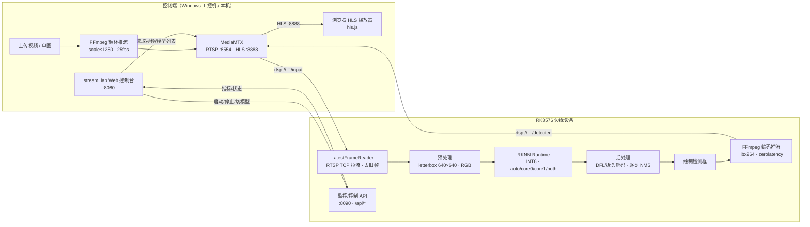

# RK3576 边缘视觉平台

**在 RK3576 边缘盒子上跑通「RTSP 拉流 → RKNN INT8 推理 → YOLO 拆头后处理 → 检测画面推流 / 低延迟 HLS 预览」的最小可用闭环，并附带板端指标监控、纯推理基准与可视化实验台。**


> 面向滑坡/落石等地质灾害场景的**板端参考实现**：模型怎么转、推理怎么拆、流怎么推、板子怎么部署、性能怎么量，每一步都有可运行的代码，而不是一份 PPT。

---

## 目录

- [平台在做什么](#平台在做什么)
- [核心特性](#核心特性)
- [拆头推理：为什么必须拆](#拆头推理为什么必须拆)
- [目录结构](#目录结构)
- [快速开始](#快速开始)
  - [0. 版本矩阵](#0-版本矩阵)
  - [1. 主机侧：ONNX 拆头与 INT8 转换](#1-主机侧onnx-拆头与-int8-转换)
  - [2. 板端环境准备](#2-板端环境准备)
  - [3. 单图 / 视频 / RTSP 推理](#3-单图--视频--rtsp-推理)
  - [4. 纯推理基准测试](#4-纯推理基准测试)
  - [5. systemd 常驻服务](#5-systemd-常驻服务)
  - [6. stream_lab 低延迟预览实验台](#6-stream_lab-低延迟预览实验台)
- [参数说明](#参数说明)
- [板端 HTTP API](#板端-http-api)
- [常见问题](#常见问题)
- [文档索引](#文档索引)
- [已知限制](#已知限制)
- [License](#license)

---

## 平台在做什么

一句话：**把摄像头/视频源搬进 RK3576 的 NPU，再把带检测框的画面搬回浏览器。**

一条完整链路只做五件事，但每一件都在真实板卡上被踩过坑：

```text
摄像头 / RTSP / 上传视频
        │
        ▼
   RTSP 拉流（TCP，丢旧帧，断流自动重连）
        │
        ▼
   letterbox 640×640 + BGR→RGB → RKNN INT8 推理（单核 / 双核 / auto）
        │
        ▼
   YOLO 输出解码（单输出 / 2 路拆头 / Rockchip 6·9 头）+ 逐类 NMS
        │
        ▼
   画框 → FFmpeg(rawvideo → libx264, zerolatency) → RTSP 推流
        │
        ▼
   MediaMTX RTSP 中转 → 低延迟 HLS → 浏览器 / VLC
```



链路中的两个关键设计：

1. **板端只认「最新帧」**：读流线程不断覆盖最新一帧，推理线程永远取最鲜的一帧，来不及处理就丢弃并在指标里累计 `frames_dropped`，避免越推越延迟。
2. **推流走独立的 FFmpeg 进程**：Python 只往管道写原始 BGR 帧，编码和 RTSP 发布交给 FFmpeg；编码器异常时通过 `stderr_tail` 回传到 `/api/status`。

## 核心特性

| 能力 | 实现 | 说明 |
|---|---|---|
| 🎯 三种 YOLO 输出布局 | `infer_rknn.py::decode_outputs` | 单输出 `[1,5,8400]`、拆头 `[1,4,N]+[1,1,N]`、Rockchip 优化模型 6/9 输出（DFL + stride 解码），按输出数量自动分派 |
| ✂️ 图级拆头 | `split_yolo_output.py` | 直接改 ONNX 计算图，插入 `Slice` 节点，把 `[1,5,8400]` 拆成独立的坐标/分数两路输出 |
| 🔢 INT8 量化转换 | `convert_onnx_to_rknn.py` | `target_platform=rk3576`，`mean=0 / std=255` 写进模型；检测到单输出图直接拒绝 INT8 并提示先拆头 |
| 📡 RTSP 实时服务 | `edge_rtsp_service.py` | 拉流、丢旧帧、推理、画框、推流、指标采样全部在一个进程内，HTTP API 支持模型热切换与单图推理 |
| ⚡ 纯推理基准 | `benchmark_rknn.py` | warmup 后统计 mean/median/p95/min/max 与 FPS，支持逐核模式对比（`auto,core0,core1,both`），排除预处理/后处理干扰 |
| 📊 板端指标 | `edge_rtsp_service.py::MetricsSampler` | `psutil` 取 CPU/内存；`/sys/kernel/debug/rknpu` 与 devfreq 取 NPU 各核负载、频率；实时产出 `capture_to_publish_ms`、耗时三段拆分 |
| 🖥️ 低延迟实验台 | `stream_lab/` | Windows 侧一键起 MediaMTX + 循环推流 + Web 控制台；HLS `lowLatency` 变体（1s 分片 / 200ms part）；看门狗自动重启源与板端管线 |
| 🧪 无板卡单测 | `test_rk3576_deploy.py`、`test_stream_lab.py` | 用伪造 runtime 校验预处理、三种输出解码、NMS、核掩码映射、模型路径越界防护、编码器限制 |
| 📄 协议集成设计 | `交互文档.md` | Detector / Agent / setUp / Cloud 四端 WebSocket 交互协议（FirmwareUpgrade 体系），含可靠告警投递与冲突仲裁规则 |

## 拆头推理：为什么必须拆

Ultralytics 默认导出的 ONNX 只有一个输出 `[1,5,8400]`：前 4 个通道是像素尺度坐标（0~640），第 5 个通道是 0~1 的置信度。

如果直接把它做成 **INT8**，坐标和分数会共用同一个量化 scale —— 坐标把 scale 撑大，分数就被量化成 0，**检测结果整体塌零**。这不是精度掉几个点的问题，而是模型直接失效。

`split_yolo_output.py` 的解法很直接：在计算图里把输出切成两路，让量化器给它们各自算 scale。

```text
[1,5,8400] ──Slice(:, 0:4)──▶ [1,4,8400]  坐标，独立 scale
           └─Slice(:, 4:5)──▶ [1,1,8400]  分数，独立 scale
```

随后 `convert_onnx_to_rknn.py` 会先检查 ONNX 输出数量，单输出 + INT8 直接报错退出，从流程上堵住这个坑。
`infer_rknn.py` 对两路输出按 YOLO 的 `cx,cy,w,h` 解码回左上/右下角点，再做阈值过滤与逐类 NMS。

如果追求 Rockchip 优化过的 YOLOv8 图（三个检测头各出 position/score，共 6 路或 9 路输出），同一份推理代码也能直接吃：`decode_rockchip_heads()` 会按 DFL 期望值解码，并按 `stride` 还原到 640 输入坐标系。

## 目录结构

```text
rk3576-edge-platform/
├── README.md                          # 本文件
├── LICENSE                            # MIT
├── THIRD_PARTY_NOTICES.md             # hls.js / MediaMTX / FFmpeg / RKNN SDK 说明
├── .gitignore                         # 权重、视频、二进制、私钥、运行时状态一律排除
│
├── infer_rknn.py                      # 推理入口：单图 / 视频 / 摄像头 / RTSP，分段计时
├── runtime_utils.py                   # RKNNLite 创建、4 种 NPU 核模式映射
├── split_yolo_output.py               # ONNX 图级拆头（INT8 前置步骤）
├── convert_onnx_to_rknn.py            # ONNX → RKNN（INT8 / FP16），target=rk3576
├── benchmark_rknn.py                  # 纯 inference() 基准，多核模式对比
├── edge_rtsp_service.py               # 板端常驻服务：拉流→推理→推流 + HTTP 监控 API
│
├── requirements-board.txt             # 板端 Python 依赖（numpy / opencv-headless）
├── requirements-host.txt              # 主机侧转换依赖（onnx）
├── landslide-edge-stream.service      # systemd unit（kickpi 用户 / conda rknn 环境）
├── calibration_500.txt                # INT8 校准图像路径清单样例（500 行）
├── agent.example.json                 # FirmwareUpgrade Agent 配置样例
├── 交互文档.md                        # Detector/Agent/setUp/Cloud 协议设计
│
├── test_rk3576_deploy.py              # 无需板卡：预处理 / 解码 / NMS / 核模式单测
├── test_stream_lab.py                 # 实验台控制器行为单测（mock 子进程）
├── docs/
│   └── deploy-notes-rk3576.md         # 早期部署笔记原文存档（版本锁定、SHA256、调频）
├── model/
│   └── README.md                      # 模型目录占位说明（*.rknn 不入库）
└── stream_lab/
    ├── README.md                      # 实验台使用说明
    ├── stream_lab_server.py           # 控制台后端 + 推流进程编排 + 看门狗
    ├── start_stream_lab.ps1           # Windows 一键启动脚本
    ├── mediamtx.yml                   # RTSP TCP + 低延迟 HLS + API 配置
    └── web/
        ├── index.html                 # 控制台页面（流控制 / 单图 / 边缘负载）
        ├── app.js                     # 轮询指标、启动/停止、上传与播放逻辑
        ├── styles.css                 # 深色控制台样式
        └── hls.min.js                 # hls.js（第三方，Apache-2.0）
```

## 快速开始

### 0. 版本矩阵

板端运行时的版本对齐比代码本身更容易出问题，先确认这一组：

| 组件 | 版本 | 位置 |
|---|---|---|
| RKNN-Toolkit2 | 2.3.2 | x86 Linux 主机，仅用于转换 |
| RKNN-Toolkit-Lite2 | 2.3.2 | RK3576 板端 |
| `librknnrt.so` | 2.3.2 | 板端 `/usr/lib/` |
| 模型 target | `rk3576` | 转换时写死 |
| 板端架构 | AArch64 | — |
| Python（板端 / 主机） | 3.10+ | 转换环境建议 3.10 |

> 官方 v2.3.2 `librknnrt.so` 的 SHA256 记录在 [docs/deploy-notes-rk3576.md](docs/deploy-notes-rk3576.md) 中，可用于核对板端运行时是否被替换。

### 1. 主机侧：ONNX 拆头与 INT8 转换

准备校准集（绝对路径，正向样本与负样本都要有）：

```bash
find /absolute/path/to/calibration_images -type f \
  \( -iname '*.jpg' -o -iname '*.jpeg' -o -iname '*.png' \) \
  | head -n 200 > calibration.txt
```

拆头（要求输入图输出严格为 `[1,5,8400]`）：

```bash
python split_yolo_output.py \
  --source best.onnx \
  --output landslide_yolov8n_split.onnx
```

INT8 转换：

```bash
python convert_onnx_to_rknn.py \
  --onnx landslide_yolov8n_split.onnx \
  --output model/landslide_yolov8n_int8_rk3576_split.rknn \
  --precision int8 \
  --dataset calibration.txt
```

只想对比精度时可显式构建 FP16（YOLO 640×640 下 FP16 明显更慢，仅用于排查）：

```bash
python convert_onnx_to_rknn.py \
  --onnx best.onnx \
  --output landslide_yolov8n_fp16_rk3576.rknn \
  --precision fp16
```

把生成的 `*.rknn` 放到板端 `/home/kickpi/landslide/rk3576_deploy/model/`。
`model/` 下的权重不会进 Git，克隆后需要自己转换或拷贝。

### 2. 板端环境准备

```bash
# 1) 确认 Lite2 与运行时版本
python -m pip show rknn-toolkit-lite2
sha256sum /usr/lib/librknnrt.so
cat /sys/kernel/debug/rknpu/version 2>/dev/null || true

# 2) 安装板端依赖（RKNNLite 需按 Rockchip 官方 wheel 单独安装）
python -m pip install -r requirements-board.txt
```

如果需要 NPU 负载/频率指标，确认 debugfs 可读（systemd unit 里已用 `ExecStartPre` 处理）：

```bash
ls /sys/kernel/debug/rknpu/
```

### 3. 单图 / 视频 / RTSP 推理

```bash
# 单图（输出文件名会沿用源图后缀）
python infer_rknn.py \
  --model model/landslide_yolov8n_int8_rk3576_split.rknn \
  --source test.jpg \
  --output result.jpg \
  --cores auto \
  --warmup 5

# 视频 / 摄像头 / RTSP，结果写成 mp4
python infer_rknn.py --model model/model.rknn --source test.mp4 --output result.mp4
python infer_rknn.py --model model/model.rknn --source 0 --output camera.mp4
python infer_rknn.py --model model/model.rknn --source 'rtsp://<user>:<pass>@<ip>:554/stream' --output rtsp.mp4
```

终端会分别打印 `preprocess_ms` / `inference_ms` / `postprocess_ms`；
视频模式额外输出 `pipeline_fps`，**不含画框与编码耗时**，不要拿它当端到端帧率。

静态 shape 模型上出现下面这行是正常的，可忽略：

```text
query RKNN_QUERY_INPUT_DYNAMIC_RANGE error, rknn model is static shape type
```

### 4. 纯推理基准测试

```bash
python benchmark_rknn.py \
  --model model/landslide_yolov8n_int8_rk3576_split.rknn \
  --image test.jpg \
  --warmup 10 \
  --runs 100 \
  --cores auto,core0,core1,both
```

输出示例字段：`mean_ms / median_ms / p95_ms / min_ms / max_ms / fps / outputs / sdk`。
测量范围只有 `runtime.inference()`，不含 resize、颜色转换、YOLO 解码、NMS、画框与写文件。

换核模式逐个跑一遍，选**最快且稳定**的那个上生产；`both`（双核）并不保证比单核快。
`docs/deploy-notes-rk3576.md` 记录了 Rockchip 公开的 YOLOv8n INT8 RK3576 单核参考值（约 90.2 FPS，满频）——自定义图会有差异，但如果只跑到个位数 FPS，通常意味着 FP16、图未优化、NPU 频率被限或者算子效率异常。

临时把 NPU governor 调到 performance 做对照（重启失效）：

```bash
echo performance | sudo tee /sys/class/devfreq/*npu*/governor
```

### 5. systemd 常驻服务

```bash
sudo cp landslide-edge-stream.service /etc/systemd/system/
sudo systemctl daemon-reload
sudo systemctl enable --now landslide-edge-stream

systemctl status landslide-edge-stream
journalctl -u landslide-edge-stream -f
curl http://127.0.0.1:8090/health
```

按现场环境修改 unit 中的 `User`、`WorkingDirectory` 与 `ExecStart` 解释器路径；
默认使用 `kickpi` 用户和 `/home/kickpi/miniconda3/envs/rknn/bin/python`。
服务监听 `0.0.0.0:8090`，上电自启、异常自动重启（`Restart=on-failure`）。

### 6. stream_lab 低延迟预览实验台

实验台跑在 **Windows 控制端**，负责「上传视频 → 循环推 RTSP → 播放板端检测结果」：

```powershell
cd stream_lab
.\start_stream_lab.ps1 -LocalIp 192.168.1.50 -BoardIp 192.168.1.100 -Ffmpeg D:\ffmpeg\bin\ffmpeg.exe
```

前置条件：

- `stream_lab/bin/mediamtx.exe`（**不入库**，自行下载；没有本地 exe 时自动尝试 `docker run bluenviron/mediamtx:1.20.0`）
- FFmpeg 可执行文件（默认 `ffmpeg`，可在脚本参数或 `stream_lab_server.py --ffmpeg` 指定）
- Python 3.10+

启动后打开 `http://<LocalIp>:8080`，页面提供：

- 上传/选择视频 → 启动实时链路（推 `rtsp://<LocalIp>:8554/input`）
- 选择板端 `*.rknn` 模型、置信度、输出 FPS、NPU 核模式
- 低延迟 HLS 预览 `http://<LocalIp>:8888/detected/index.m3u8`
- 单图检测（转发到板端 `/api/infer/image`）
- CPU / NPU / 内存 / 各核负载 / 频率 / 采集到发布延迟等指标

自动循环推流并带看门狗：

```powershell
.\start_stream_lab.ps1 -AutoStart -AutoStartVideo test.mp4
```

## 参数说明

### `infer_rknn.py`

| 参数 | 类型 / 取值 | 默认值 | 说明 |
|---|---|---|---|
| `--model` | Path，**必填** | — | `.rknn` 模型路径，不存在直接报错 |
| `--source` | 字符串，**必填** | — | 图片路径、视频路径、RTSP URL，或纯数字摄像头索引 |
| `--output` | Path | `result.mp4` | 输出文件；图片输入时自动沿用源图后缀 |
| `--labels` | Path | `None` | 类别标签文件（每行一个）；缺省为 `["landslide"]` |
| `--imgsz` | int | `640` | 网络输入边长，letterbox 目标尺寸 |
| `--conf` | float | `0.35` | 置信度阈值 |
| `--iou` | float | `0.6` | NMS IoU 阈值（逐类别执行） |
| `--cores` | `auto` / `core0` / `core1` / `both` | `auto` | NPU 核掩码模式 |
| `--warmup` | int ≥ 0 | `5` | 正式推理前的预热帧/次数 |
| `--max-frames` | int ≥ 0 | `0` | 视频最大处理帧数，`0` 表示不限 |
| `--verbose` | flag | 关闭 | 打开 RKNN 运行时日志 |

### `edge_rtsp_service.py`

| 参数 | 类型 / 取值 | 默认值 | 说明 |
|---|---|---|---|
| `--model` | Path | `None` | 初始模型；缺省按 `--model-dir` 下的默认名查找，再退化为目录中第一个 `*.rknn` |
| `--model-dir` | Path | 脚本同级 `model/` | 模型目录，也是模型热切换的白名单目录 |
| `--labels` | Path | `None` | 类别标签文件 |
| `--host` | 字符串 | `0.0.0.0` | HTTP 监听地址 |
| `--port` | int | `8090` | HTTP 监听端口 |

### `benchmark_rknn.py`

| 参数 | 默认值 | 说明 |
|---|---|---|
| `--model` | 必填 | 待测 `.rknn` |
| `--image` | `None` | 输入图片；省略时用全零张量，只测纯算力 |
| `--imgsz` | `640` | 输入尺寸 |
| `--warmup` | `10` | 预热次数 |
| `--runs` | `100` | 统计样本数 |
| `--cores` | `auto` | 逗号分隔的多模式，如 `auto,core0,core1,both` |
| `--verbose` | 关闭 | RKNN 运行时日志 |

### `convert_onnx_to_rknn.py` / `split_yolo_output.py`

| 参数 | 默认值 | 说明 |
|---|---|---|
| `--onnx` / `--source` | 必填 | 输入 ONNX |
| `--output` | 必填 | 输出 ONNX / RKNN |
| `--precision` | `int8` | `int8` 或 `fp16`；`int8` 必须提供 `--dataset` |
| `--dataset` | `None` | INT8 校准图像清单（每行一个绝对路径） |
| `--verbose` | 关闭 | Toolkit 日志 |

## 板端 HTTP API

`edge_rtsp_service.py` 默认监听 `:8090`，无鉴权，仅建议在可信局域网使用。

| 方法 | 路径 | 说明 |
|---|---|---|
| `GET` | `/health`、`/api/health` | 存活检查，返回 `{"ok":true,"service":"rk3576-edge-stream"}` |
| `GET` | `/metrics`、`/api/metrics` | 最新指标快照：CPU、内存、进程 RSS、NPU 各核、频率、管线耗时、FPS、丢弃帧 |
| `GET` | `/api/models` | 模型目录内 `*.rknn` 列表与当前激活模型 |
| `GET` | `/api/status` | 管线状态：运行/连接/推流/FPS/检测数/最后错误 |
| `POST` | `/api/infer/image` | Base64 单图检测（≤24MB），返回画框后的 JPEG Base64 与耗时 |
| `POST` | `/api/pipeline/start` | 启动视频管线，JSON 见下，返回 `202` |
| `POST` | `/api/pipeline/stop` | 停止管线 |

`/api/pipeline/start` 请求体（键名与代码一致）：

```json
{
  "source_url": "rtsp://192.168.1.50:8554/input",
  "publish_url": "rtsp://192.168.1.50:8554/detected",
  "model": "landslide_yolov8n_int8_rk3576_split.rknn",
  "cores": "both",
  "warmup": 20,
  "imgsz": 640,
  "conf": 0.35,
  "iou": 0.6,
  "output_fps": 25,
  "output_max_side": 1280,
  "encoder": "libx264"
}
```

> 模型名只能是 `--model-dir` 下的文件名，带路径或非 `.rknn` 后缀会被拒绝（防目录穿越）。

## 常见问题

**Q1：`rknn-toolkit-lite2 is not installed` 或 `init_runtime` 失败？**
按错误提示逐项核对：Lite2 是否为 2.3.2、`librknnrt.so` 是否被系统包覆盖、模型 target 是否为 `rk3576`、RKNPU 驱动版本是否与运行时匹配。先用单图推理排除业务代码问题，再上服务。

**Q2：转换时报「Refusing INT8 conversion for a monolithic YOLO output」？**
这是预期行为。先用 `split_yolo_output.py` 拆成两路输出再转 INT8；不要绕过检查，否则分数会塌零。

**Q3：`This splitter expects output shape [1, 5, 8400]`？**
拆头脚本只处理单类别、单输出、640×640、8400 锚点的 Ultralytics 导出。多类别或多尺度导出请改用 Rockchip 的 YOLOv8 导出流程，`infer_rknn.py` 支持 6/9 路输出模型，不需要拆头脚本。

**Q4：仓库里为什么没有 `.rknn` / `.onnx` / 测试视频？**
权重与视频体积大且属于训练/测试产物，`.gitignore` 已整体排除。使用前需按上文自行转换或放置到 `model/`。
`calibration_500.txt` 只是 500 行校准清单的**格式样例**，里面的路径来自构建机，需替换成本机路径。

**Q5：没有板卡能跑测试吗？**
可以。两个单测都使用伪造 runtime 或 mock 子进程：

```bash
python -m pip install numpy opencv-python psutil
python -m unittest -v test_rk3576_deploy.py test_stream_lab.py
```

**Q6：stream_lab 为什么只能用 `libx264`？**
控制器会显式拒绝其它编码器，当前 RK3576 镜像上硬件编码器路径未打通，CPU 软编是唯一验证过的方案。

**Q7：视频源断开会怎样？**
板端读流线程每 0.5~1 秒自动重连并写 `last_error`；stream_lab 看门狗每 2 秒体检，源进程死掉会重启推流，板端管线报错会重启管线（20 秒宽限期）。

**Q8：页面上的「NPU 进程内存」是显存吗？**
不是。RKNPU 驱动没有暴露独立 NPU 内存统计，该值取自推理进程 RSS，仅作趋势参考。

## 文档索引

| 文档 | 内容 |
|---|---|
| [README.md](README.md) | 本文件：总体架构、部署与参数 |
| [docs/deploy-notes-rk3576.md](docs/deploy-notes-rk3576.md) | 早期部署笔记原文：版本锁定、`librknnrt.so` SHA256、校准集生成、基准判读、调频命令 |
| [stream_lab/README.md](stream_lab/README.md) | 实验台地址、启动方式、防火墙端口、指标口径 |
| [交互文档.md](交互文档.md) | FirmwareUpgrade 体系：Detector / Agent / setUp / Cloud 的 WebSocket 协议、告警可靠投递、双管理端仲裁 |
| [model/README.md](model/README.md) | 模型目录约定（权重不入库） |
| [THIRD_PARTY_NOTICES.md](THIRD_PARTY_NOTICES.md) | 第三方组件与许可证 |

> `交互文档.md` 与 `agent.example.json` 描述的是**设备管理侧**（FirmwareUpgrade）的集成协议与 Agent 配置；本仓库当前的板端服务是 `:8090` 上的 HTTP 监控/控制 API，文档中的 Detector WebSocket 协议属于待落地集成设计，阅读时注意区分。

## 已知限制

- **单类别优先**：拆头路径固定单类别（`classes=0`，默认标签 `landslide`）；多类别需使用单输出多通道模型或 Rockchip 6/9 头模型，并显式传 `--labels`。
- **单路串行推理**：一个服务进程对应一路视频管线，没有多路并行调度；单图请求会与视频推理争用同一把 `infer_gate` 锁。
- **CPU 软编**：板端推流与实验台源推流均使用 `libx264`；高分辨率/高帧率下编码会成为瓶颈。
- **端到端延迟未闭环测量**：`capture_to_publish_ms` 只覆盖「取到帧 → 写入编码器」，不含编码排队、RTSP 传输、HLS 分片与浏览器缓冲。
- **HTTP API 无鉴权**：服务默认监听 `0.0.0.0:8090`，务必放在受控网段或自行加反向代理鉴权。
- **转换依赖单独环境**：RKNN-Toolkit2 2.3.2 不在 PyPI，需要 x86 Linux + 官方 wheel；本仓库不打包该环境。
- **无精度指标入库**：仓库不附带 mAP、召回率等测试数据，也不提供固定 FPS 承诺；性能请用 `benchmark_rknn.py` 在目标板卡上实测。
- **Detector WebSocket 未实现**：见上节说明，Agent/setUp/Cloud 联调前需要补齐协议层。

## License

本项目采用 [MIT License](LICENSE)。随仓库分发的 `stream_lab/web/hls.min.js` 为第三方组件（hls.js，Apache-2.0），详见 [THIRD_PARTY_NOTICES.md](THIRD_PARTY_NOTICES.md)。

```bash
git clone https://github.com/SolitudeZY/rk3576-edge-platform.git
```
